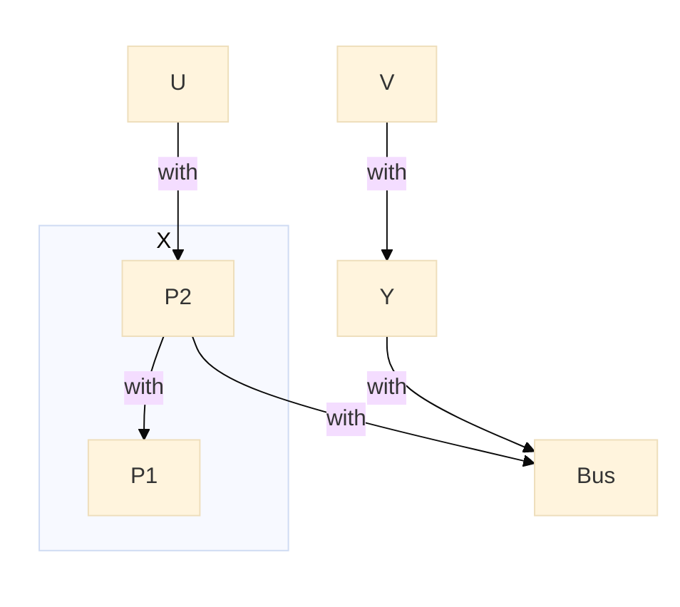
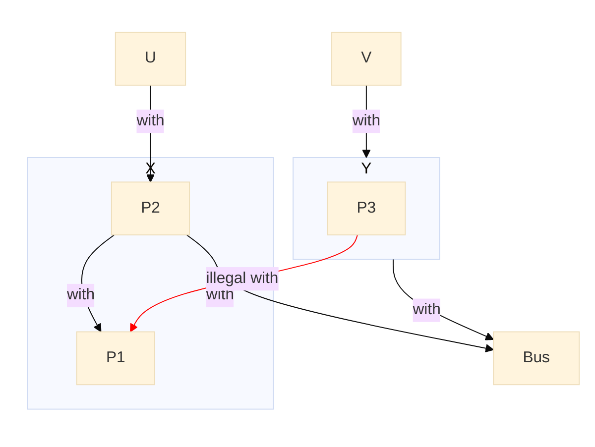

# Feature: Independent Component test suite <!-- omit from toc -->

- [Scenario: Test Independent Components](#scenario-test-independent-components)
- [Scenario: Test broken Independent Components rule](#scenario-test-broken-independent-components-rule)


This test suite validates the independent components functionality.

## Scenario: Test Independent Components



All dependencies stay inside the X or Y component families:
X and Y are independent, no output expected.

- Given there is no `dir1` directory
- And   I run `./create_pkg X.P1 spec -in dir1` Successfully
- And   I run `./create_pkg Bus spec -in dir1` Successfully
- And   I run `./create_pkg X.P2 spec -in dir1 -with X.P1 -with Bus` Successfully
- And   I run `./create_pkg Y spec -in dir1 -with Bus` Successfully
- And   I run `./create_pkg U spec -in dir1 -with X.P2` Successfully
- And   I run `./create_pkg V spec -in dir1 -with Y` Successfully
- Given the file `rules1.txt`
```
X and Y are independent
```
- When I run `./acc rules1.txt -I dir1`
- Then I get no output

## Scenario: Test broken Independent Components rule



- Given there is no `dir1` directory
- And   I run `./create_pkg X.P1 spec -in dir1` Successfully
- And   I run `./create_pkg Bus spec -in dir1` Successfully
- And   I run `./create_pkg X.P2 spec -in dir1 -with X.P1 -with Bus` Successfully
- And   I run `./create_pkg Y spec -in dir1 -with Bus` Successfully
- And   I run `./create_pkg Y.P3 spec -in dir1 -with X.P1` Successfully

- Given the file `rules1.txt`
```
X and Y are independent
```
- When I run `./acc rules1.txt -I dir1`
- Then output is
```
Error : dir1/y-p3.ads:1: X and Y must be independent
```
